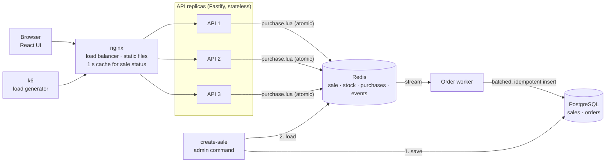
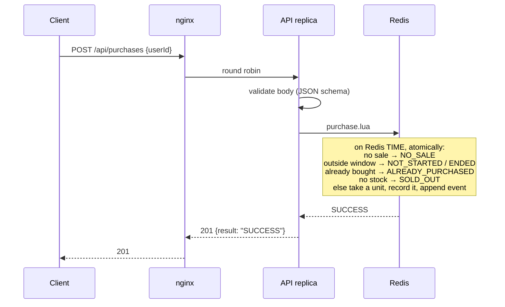
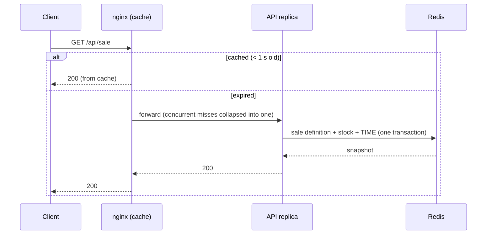

# High-Throughput Flash Sale

A flash sale system for one limited-stock product. Each user may buy one unit, only during the sale window, while thousands of requests arrive at once.

- **Correct under load:** every purchase decision (sale window, one per user, stock) is made by one atomic Redis script, on one clock. Stress tests at tens of thousands of requests per second find no oversell and no duplicate purchase, including when an API replica is killed or Redis is restarted mid-sale.
- **Fast:** the purchase path is one Redis round trip. The database is kept off the hot path.
- **Robust:** the API fails closed when Redis is unavailable. No accepted purchase is lost. The client recovers purchases whose response was lost in transit.

```bash
./scripts/demo.sh        # build and start everything, create a sale that opens in 30 s
open http://localhost:8080
./stress/run.sh          # stress test: create sale -> load -> verify invariants
```

## Contents

1. [Architecture](#architecture)
2. [Technology choices](#technology-choices)
3. [Data model](#data-model)
4. [Design decisions and trade-offs](#design-decisions-and-trade-offs)
5. [API](#api)
6. [Frontend](#frontend)
7. [Running the project](#running-the-project)
8. [Testing](#testing)
9. [Stress testing](#stress-testing)
10. [Project structure](#project-structure)

---

## Architecture



A sale is **defined** in Postgres, **loaded** into Redis where every purchase is decided, and **recorded** back into Postgres as orders by the worker.

### Request flows

**Purchase.** nginx picks a replica; the replica validates the body and runs the purchase script. The script decides everything in one atomic step.



**Sale status.** Every open page polls it. nginx serves it from a 1 s cache, so Redis sees about one read per second however many people are watching.



**Order persistence** runs in the background, after the user has their answer ([§5](#5-asynchronous-persistence-at-least-once)).

### Components

| Component | Role |
|---|---|
| **nginx** | Single entry point: serves the React app, load-balances `/api` across replicas, caches sale status for 1 s |
| **API** (×3) | Validates input, runs the purchase script, maps outcomes to HTTP. Stateless, so replicas can be added freely |
| **Redis** | Holds the running sale and decides every purchase |
| **Order worker** | Moves purchases from the Redis stream into Postgres |
| **PostgreSQL** | Source of record for sales and orders. Not needed to sell: if it is down, the sale keeps running |
| **migrate** | One-off job that applies schema migrations; the worker starts after it succeeds |
| **create-sale** | Admin command: saves a sale to Postgres, then loads it into Redis |

---

## Technology choices

Where the brief left a choice, this is what I picked and why.

| Area | Choice | Why | Viable alternative |
|---|---|---|---|
| Language | TypeScript | Types across API schemas, service and tests | — |
| Backend framework | **Fastify** | Thin, fast hot path: compiled JSON-schema validation and serialization. Three endpoints need no DI framework; plain layers and factory functions keep it explicit | **NestJS**: strong structure and DI, which pays off in larger codebases; here it adds layers without benefit |
| Frontend | React (required) + **Vite** | A static single-page app; Vite builds it in milliseconds and nginx serves it | Next.js: server rendering and routing are not needed for one page |
| Purchase decisions | **Redis** + Lua | Atomic, in-memory, microseconds per decision ([why](#1-redis-in-front-of-the-database)) | Postgres conditional `UPDATE`: correct, but one hot row becomes the bottleneck |
| Queue | **Redis Streams** | Can be written in the same atomic script as the purchase ([why](#4-the-outbox-lives-in-the-script)) | Kafka / SQS: better for many consumers or long retention, but cannot join the atomic step |
| Database | **PostgreSQL** + `node-pg-migrate` | Relational records with constraints; migrations are plain SQL files | An ORM (Prisma, Drizzle): unnecessary for two tables |
| Runtime environment | **Docker Compose** | One command for reviewers; replicas and failures are easy to simulate | Kubernetes: the production target, too heavy to run for a review |
| Tests | **Vitest** + **Testcontainers** | Fast TS-native runner; integration tests use real, throwaway Redis and Postgres | Jest: equivalent, slower with ESM/TS |
| Load testing | **k6** | Scripts in JavaScript; runs from a Docker image; arrival-rate load that does not slow down when the server does, like a real crowd; low CPU use | **Artillery**: also JS with arrival rates, but heavier on CPU, which matters when generator and system share one machine |

---

## Data model

**PostgreSQL** (records), managed by [migrations](server/migrations):

`sales`: what is sold, when, and how many

| Column | Type | Notes |
|---|---|---|
| `id` | text | primary key |
| `starts_at` | timestamptz | |
| `ends_at` | timestamptz | `CHECK (ends_at > starts_at)` |
| `total_stock` | integer | `CHECK (total_stock > 0)` |
| `created_at` | timestamptz | default `now()` |

`orders`: one row per successful purchase

| Column | Type | Notes |
|---|---|---|
| `sale_id` | text | primary key (with `user_id`); FK → `sales.id`, `ON DELETE CASCADE` |
| `user_id` | text | primary key (with `sale_id`): an independent "one per user" guarantee |
| `purchased_at` | timestamptz | decision time, from the Redis clock |
| `persisted_at` | timestamptz | default `now()`; minus `purchased_at` gives the persistence lag |

**Redis** (the running sale):

| Key | Type | Content |
|---|---|---|
| `sale:{id}:meta` | hash | `startsAt`, `endsAt` (epoch ms), `totalStock` |
| `sale:{id}:stock` | string | remaining units |
| `sale:{id}:purchases` | hash | `userId` → purchase time (epoch ms, Redis clock) |
| `sale:{id}:events` | stream | one entry per purchase, consumed by the worker |

The `{id}` hash tag keeps a sale's keys in one Redis Cluster slot, as multi-key scripts require. Keys are per sale, so several sales can run side by side.

---

## Design decisions and trade-offs

### 1. Redis in front of the database

Writing straight to the database is correct too: `UPDATE ... SET stock = stock - 1 WHERE stock > 0` plus a unique `(sale_id, user_id)`. But in a flash sale, tens of thousands of requests write **the same row** within seconds; they serialize on its lock and exhaust connections. Redis makes that contended decision in memory, and Postgres receives only the successful purchases, at the worker's pace.

### 2. One script, one clock

[`purchase.lua`](server/src/sale/purchase.lua) checks the sale window, one-per-user and stock, then takes the unit. Redis runs a script to completion before anything else, so attempts cannot interleave. Overselling and duplicate purchases are impossible without any lock.

The window is checked **inside the script against Redis `TIME`**, not by each replica, whose clocks could disagree at the opening second. The status endpoint returns the same time as `serverTime`, and the UI counts down on it.

### 3. The sale is defined in Postgres and run from Redis

A sale is business data, so it lives in a table that orders reference. `create-sale` saves the row, then loads it into Redis, like warming a cache before the drop. Replicas only know `SALE_ID`, so restarting them cannot change a running sale.

### 4. The outbox lives in the script

"Take the unit, then publish to a queue" loses the purchase if the process dies in between. Here the event is appended to a Redis Stream **in the same atomic script**, so both exist or neither does. Kafka or SQS cannot join that step; with many consumers, the stream would be relayed into Kafka.

### 5. Asynchronous persistence, at least once

The [worker](server/src/persistence/order.worker.ts) acknowledges events only **after** the Postgres commit.
- A failed insert leaves the events pending and they are retried.
- Events held by a crashed worker are taken over after 30 s (`XAUTOCLAIM`).
- Duplicates are ignored by the primary key.

Postgres trails Redis briefly, so a confirmed purchase exists only in Redis at first. Redis therefore uses AOF with `appendfsync always`. With the default (`everysec`), a crash could lose a second of confirmed purchases, and their stock would be sold again. Redis syncs once per batch of commands, so this still sustains about 36,000 purchases/s.

### 6. Fail closed, and recover unknown outcomes

When Redis is unreachable, the API answers **503 with `Retry-After: 2`** within about a second instead of queueing requests or guessing. The UI disables "Buy" for that long, so clients do not stampede Redis when it returns.

A purchase can also commit while its response is lost. Retries are safe (they can only return `ALREADY_PURCHASED`), and on a 5xx or network error the UI checks `GET /api/purchases/:userId` before showing a failure.

### 7. Status by cached polling

70,000 pages polling every 2 s is 35,000 status requests per second. nginx caches the status for 1 s and collapses concurrent misses: 10,000 requests over 5 s caused 3 Redis reads instead of 10,002. Purchases are never cached.

Server-Sent Events would push updates instead, but at this scale that means tens of thousands of open connections and reconnect storms on deploys. Polling costs one to two seconds of display latency instead.

### 8. Horizontal scaling and load balancing

API replicas hold no state: `API_REPLICAS=5 docker compose up -d`. Each is limited to one CPU so replica counts can be compared. [Measured](#capacity-by-replica-count): one replica peaks at about 29,000 purchases/s and collapses above that. From two replicas on, the total stops near 36,000, where Redis (one core for all scripts) is the limit; more replicas then keep latency steady under overload.

nginx round-robins across replicas and retries a request elsewhere when the connection fails; it never replays a purchase that was delivered. Replicas are never taken out of rotation (`max_fails=0`). nginx's default removes a replica for 10 s after one slow connection, so a burst that slows every replica would remove them all and turn overload into an outage. The cost is that requests to a crashed replica wait out the 1 s connect timeout.

In production a managed load balancer would replace nginx: no single point of failure, replica discovery, and active health checks. Under Kubernetes the API would autoscale, but for a flash sale it should be scaled up **before** the opening, because the spike arrives faster than autoscaling reacts.

### 9. Time zones

Data is UTC end to end: epoch ms in Redis, `TIMESTAMPTZ` in Postgres, ISO-8601 `Z` in the API, so the sale opens at the same instant everywhere. The page shows that instant in the **viewer's local time, with the zone** (`1 Dec 2026, 7:00 am GMT+9` in Seoul, `9:00 am AEDT` in Sydney).

### Out of scope

- **Authentication.** The brief asks for a user identifier, so `userId` is trusted. With accounts, a hook would take it from the session; the service and script would not change.
- **Waiting room and bot protection.** Admission tokens, per-user limits and CAPTCHA belong at the edge, and would also throttle the stress test.
- **Admin UI.** `create-sale` is the admin action.
- **High availability.** Redis and nginx are single instances. Redis replication is asynchronous, so a failover could drop confirmed purchases and oversell; a replicated setup needs `WAIT` before answering, or reconciliation against `orders`.

---

## API

| Method | Path | Responses |
|---|---|---|
| `GET` | `/api/sale` | `200 { status, serverTime, startsAt, endsAt, totalStock, remaining }` · `404 { error: "NO_SALE" }` |
| `POST` | `/api/purchases` `{ "userId": "alice" }` | `201 SUCCESS` · `409 ALREADY_PURCHASED` · `410 SOLD_OUT` · `403 NOT_STARTED` / `ENDED` · `404 NO_SALE` · `400` invalid input · `503` unavailable, with `Retry-After` |
| `GET` | `/api/purchases/:userId` | `200 { purchased, purchasedAt }` |
| `GET` | `/health` | `200` if Redis responds, else `503` |

`status` is one of `upcoming`, `active`, `sold_out`, `ended`. Purchase responses always carry `{ "result": "<OUTCOME>" }`. `userId` is 1–64 characters from `[A-Za-z0-9._@+-]`.

## Frontend

One page: status badge, countdown, remaining stock, a user ID field and the buy button. The button follows the sale (`Opens soon` → `Buy now` → `Sold out` / `Drop ended`), shows `Try again in Ns` during a back-off, and becomes `Purchased ✓` once that ID owns an item.

---

## Running the project

### Prerequisites

- **Docker** with Compose v2: required for everything below.
- **Node.js 24** and **pnpm 10**: only for unit/integration tests and local development.
- The scripts are bash: macOS and Linux run them as is; on Windows use WSL.

### Run with Docker

```bash
./scripts/demo.sh
```

This builds the images, starts the stack and creates a sale that opens in 30 s and runs for 10 minutes with 100 units, then open http://localhost:8080. The first build takes a minute or two. Options:

```bash
STARTS_IN=10 DURATION=120 SALE_STOCK=5 ./scripts/demo.sh
```

### Create or replace a sale

```bash
docker compose run --rm --no-deps api node dist/cli/create-sale.js --replace \
  --stock 100 --starts-at 2026-12-01T09:00:00Z --ends-at 2026-12-01T10:00:00Z
# or relative to now:  --starts-in 30 --duration 600
```

Without `--replace`, creating a sale whose ID already exists fails, so a running sale is not wiped by accident. With it, the sale's orders and Redis state are reset.

### Configuration

| Variable | Default | |
|---|---|---|
| `SALE_ID` | `launch` | Which sale the API and worker serve |
| `API_REPLICAS` | `3` | Number of API containers |
| `API_CPUS` | `1` | CPU limit per API container |

### Local development

```bash
pnpm install
docker compose up -d redis postgres
pnpm --filter server migrate
pnpm --filter server create-sale --replace --stock 100 --starts-in 10 --duration 3600
pnpm dev:server     # API on :3000
pnpm dev:worker
pnpm dev:web        # http://localhost:5173, proxies /api to :3000
```

### Stop and clean up

```bash
docker compose down        # stop
docker compose down -v     # stop and delete Redis/Postgres data
```

---

## Testing

```bash
pnpm test            # all server and web tests (Docker must be running for the integration tests)
pnpm test:coverage   # the same, plus HTML coverage reports in server/coverage and web/coverage
```

Without Docker, run only the unit tests: `pnpm --filter server test:unit`. The output ends with:

```
server test:       Tests  64 passed (64)
web test:          Tests  17 passed (17)
```

**What is covered**

| Suite | Tests | Highlights |
|---|---|---|
| Server unit | 44 | Status at window boundaries, sale validation, HTTP mapping of every outcome, input validation, 503 with `Retry-After` |
| Server integration | 20 | 2,000 users for 100 units over 8 connections give exactly 100 sales. One user firing 500 parallel requests gets exactly 1. The window is enforced on the Redis clock. The worker persists exactly once and survives DB errors and crashed consumers. Foreign keys hold |
| Web | 17 | Lost-response recovery, `Retry-After` back-off, ownership state, time formatting in different zones |

Coverage: server 90% of statements (entry points and CLIs excluded; the stress runs exercise them). Web: the logic modules are covered; the `fetch` wrapper and React hooks are not unit-tested.

---

## Stress testing

Only Docker is needed: k6 and the verifier run in containers.

```bash
./stress/run.sh        # correctness: a crowd far larger than the stock (~1 min)
./stress/capacity.sh   # capacity: how much load it sustains (~2 min)
./stress/compare.sh    # capacity with 1, 2, 3 and 4 API replicas (~10 min)
```

To inject a failure mid-sale, add `CHAOS=api` (kill an API replica) or `CHAOS=redis` (restart Redis) to `run.sh`, with `SALE_STOCK=20000` so the sale is still selling when it hits.

### Reading the results

Each run prints a summary and saves a folder:

```
stress/results/<time>-<test>/
  report.html    graphs over time: request rate, latency, errors (open in a browser)
  steps.md       capacity table (capacity runs)
  verify.txt     invariant checks
  summary.json   raw k6 results
```

`compare.sh` adds `stress/results/compare-<time>/compare.md` (and `compare.html`) with per-step medians and ranges for each configuration. `CONFIGS="1 3" RUNS=3` changes the replica counts and repetitions.

### Correctness test

[`flash-sale.js`](stress/flash-sale.js) runs three traffic patterns **at once** against 100 units:

| Scenario | Load | Simulates |
|---|---|---|
| `crowd` | ramps to 2,000 new users/s, holds 30 s (~70k users) | the opening rush, demand far above stock |
| `greedy` | 100 virtual users looping over 20 user IDs | users or bots hammering "Buy" from several tabs |
| `viewers` | 200 status requests/s | open sale pages polling |

`verify` then checks Redis and Postgres: stock never negative, sold = total − remaining, no oversell, every purchase persisted, and every HTTP 201 backed by a purchase. It also reports how long persistence took to catch up.

```
PASS  stock never negative                     stock=0
PASS  sold = initial stock - remaining         purchases=100, initial=100, remaining=0
PASS  no oversell                              purchases=100 <= 100
PASS  every reservation persisted to Postgres  orders=100, purchases=100
PASS  every HTTP 201 backed by a reservation   k6 successes=100, purchases=100, responses lost in transit=0
INFO  persistence backlog when load stopped: 0 orders, drained in 0.0 s
```

### Capacity test

[`capacity.js`](stress/capacity.js) raises the purchase rate step by step: 4,000 → 8,000 → 16,000 → 24,000, then in 4,000 steps up to 44,000 requests/s, 10 s each. Every request comes from a new user and stock is unlimited, so each one takes the heaviest path. The load is open-model: arrivals do not wait for responses.

A step **passes** when the achieved rate is at least 95% of the target, p99 is under 50 ms and errors are under 0.1%. Each step is judged on its own; `STEPS` and `STEP_DURATION` change them.

### Results

All results come from one machine: Docker with 10 CPUs and 8 GB of memory runs the whole stack and the k6 load generator. Each API replica is limited to 1 CPU. Numbers will differ on other hardware; the shape of the results is what matters.

#### Correctness

**Baseline (100 units, 40 s):** 858,036 requests (21,447 req/s on average), 0 errors, verify 5/5.

| Scenario | Requests | p50 | p95 | p99 | Outcomes |
|---|---|---|---|---|---|
| `crowd` | 70,249 | 0.7 ms | 5.0 ms | 9.9 ms | 80 × 201, 70,169 × 410 sold out |
| `greedy` | 781,786 | 2.0 ms | 5.4 ms | 9.7 ms | **20 × 201** (one per ID), 781,766 × 409 |
| `viewers` | 6,001 | 0.2 ms | 2.2 ms | 5.1 ms | status served mostly from the nginx cache |

**With a failure at t = 10 s (20,000 units, still selling):**

| Failure | Units sold | Persisted | Failed requests | Responses lost | Crowd p95 / p99 | verify |
|---|---|---|---|---|---|---|
| API replica killed, back after 5 s | **20,000** | 20,000 | 23 | 0 | 22.9 / 1,001.7 ms | 5/5 |
| Redis restarted | **20,000** | 20,000 | 60,995 | 5 | 20.0 / 52.5 ms | 5/5 |

- **No oversell and no duplicate purchase in any run**, including the 20 `greedy` IDs hammered by 5 virtual users each.
- **Killed replica:** only its in-flight requests failed. Requests sent to it afterwards waited out the 1 s connect timeout and went to another replica (the 1 s p99).
- **Redis restart:** purchases got a fast 503 while Redis was down, never a wrong answer. The error count is high because `greedy` retries without honouring `Retry-After`. AOF kept stock and purchases intact.
- **Lost responses** are purchases that committed while the response did not arrive; the UI's lookup after an error shows them ([§6](#6-fail-closed-and-recover-unknown-outcomes)).

#### Capacity by replica count

`STEPS=24000,28000,32000,36000,40000,44000 CONFIGS="1 2 3 4" RUNS=3 ./stress/compare.sh`, run three times: 9 runs per configuration, all verify 5/5. Every request is a full purchase (up to 2.4 million per run).

| API replicas | Peak req/s (mean ± sd) | p99 at 28,000 req/s | At 44,000 req/s |
|---|---|---|---|
| 1 | 29,432 ± 1,181 | 55 ms | collapses: 2,166 req/s, 66% errors |
| 2 | 36,593 ± 984 | 30 ms | 30,380 req/s, p99 585 ms |
| 3 | 36,310 ± 1,090 | 31 ms | 36,174 req/s, p99 97 ms |
| 4 | 35,432 ± 853 | 29 ms | 35,337 req/s, p99 76 ms |

Medians of 9 runs, except the peak.

- **One replica** hits its 1-CPU limit at about 29,000 req/s and collapses past it. The fix would be load shedding (nginx `limit_req`, Fastify `under-pressure`); not added, since a second replica avoids it.
- **From two replicas on, the total stops near 36,000 req/s:** Redis, which runs every script on one core, was at 100% CPU. More replicas then mainly keep throughput and latency steady under overload. Going further would mean sharding the stock.
- **This is the worst case:** every request buys and writes to the AOF. In a real sale stock runs out in seconds and refusals write nothing: sold out, 3 replicas answered 40,000 req/s with p99 under 40 ms and Redis at about 60% CPU.
- **Persistence catches up:** up to 1.9 million orders were waiting when the load stopped, all stored within about 70 s. Purchases never wait on Postgres.
- **Peak throughput is reproducible** (within 6% across the three sessions). The highest passing step is not: around 32,000–36,000 req/s, p99 sits right at the 50 ms line. Keep the machine idle while measuring.

---

## Project structure

```
.
├── docker-compose.yml          redis, postgres, migrate, api ×N, worker, web (nginx), k6
├── scripts/demo.sh             start the stack and a sale opening in N seconds
├── server/
│   ├── migrations/             SQL migrations
│   └── src/
│       ├── server.ts           API entry point
│       ├── worker.ts           order worker entry point
│       ├── app.ts              Fastify app (also used by tests)
│       ├── sale/               sale model, routes → service → repository, purchase.lua
│       ├── persistence/        worker, orders and sales tables
│       └── cli/                migrate, create-sale, verify
├── web/
│   ├── src/                    React app; purchase.ts and time.ts hold the logic
│   └── nginx.conf              load balancing, status cache, static files
└── stress/
    ├── flash-sale.js           correctness scenarios
    ├── capacity.js             step load to find capacity
    ├── run.sh · capacity.sh · compare.sh
    └── results/                one folder per run (git-ignored)
```
